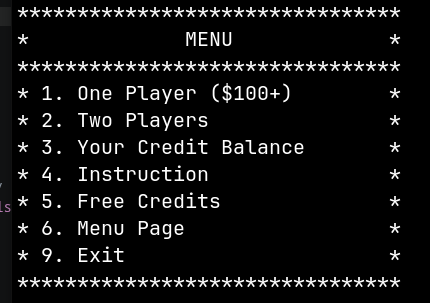
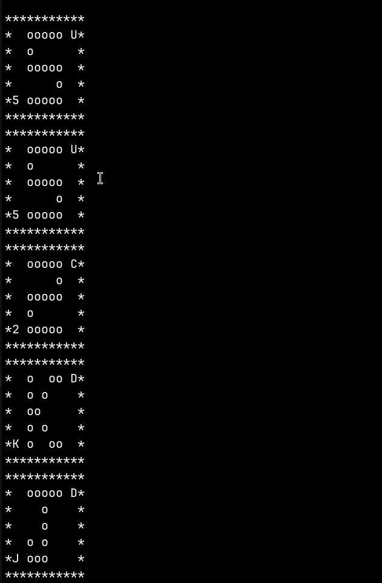
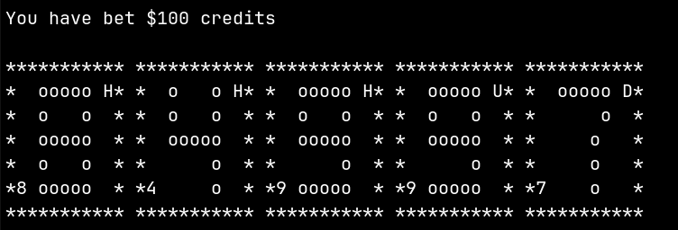
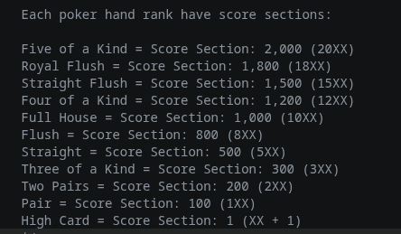
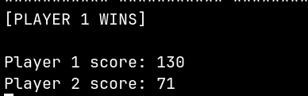

# Deluxe Poker System
 <br><br>
  
<br><br>

<h2>📜 Details and Instructions:</h2>
For this project, I am currently working on a C++ project called Deluxe-Poker-System(Poker game). When running this project, it will display the menu bar and it will print each number of inputs from the list. All four inputs from the list are single player mode, two player mode, instructions, free credits, and display credits.<br><br>

Menu code snippet example:<br>
 <br><br>

<h3>Poker Hand Ranks:</h3>
Here are all types of poker hands from best to worst: <br><br>
🥇 Five of a Kind<br>
🥈 Royal Flush<br>
🥉 Straight Flush<br>
4. Four of a Kind<br>
5. Full House<br>
6. Flush<br>
7. Straight<br>
8. Three of a Kind<br>
9. Double Pairs<br>
10. Pair<br>
11. High Card<br><br>

There are a total of 65 deck of cards. Numbers (from Ace to 10), Face (Jack, Queen, and then King), then 5 suits (Heart, Diamond, Club, Spade, and Quatrefoil).<br><br>

<h3>Five of a Kind: </h3><p>This poker hand is exclusively available for this project instead of Royal Flush hand being the best poker hand. Here is an example of a poker hand of five of a kind: </p><br>
(5/Heart, 5/Diamond, 5/Club, 5/Spade, 5/Quatrefoil)<br>
(K/Heart, K/Diamond, K/Club, K/Spade, K/Quatrefoil)<br><br>

<h2>CMake Details</h2>

⚠️ It is highly recommended to use CMake v3.31 or later to function this project without a problem ⚠️ <br>

One of the tools that I have been using to work on my project is called CMake and it is an open-source meta-build system that can allow to connect or merge all C++ and header files. Like on Windows OS, Microsoft Visual Studio is perfect for users that are creating C++ projects, but for Linux, CMake is highly recommended so that it can build C/C++ projects.<br><br>

<h4>Here are some examples of implementing CMake to build each files for this project:</h4>
Deluxe-Poker-System/CMakeLists.txt file (top level)<br>

```
cmake_minimum_required(VERSION 3.31)
project(Deluxe-Poker-System)
set(CMAKE-CXX-STANDARD 20)
```
<br>
Line 39: The current version of CMake that will build this project<br>
Line 40: The title of the project<br>
Line 41: Calling the version of C++ for CMake (C++20 is recommended for new C++ features)<br><br>

<h2>Overcome Challenges</h2>

<h4>CMake and G++ compiler</h4>
- This project was my very first time implementing a CMake and g++ and use it as my full built-in system. Using g++ for the first time was not as difficult, but building a CMake to my project took me a while to build, especially when I created multiple C++ files including the header.<br>

<h3>onePlayer.cpp file</h3>

<h4>Implementing Poker Hand Rank</h4>
- For the poker hand rank, I have to implement one of the data structure strategies to fully function the poker hand rank system which is called Hash Tables. I use an unordered_map strategy with characters as a key and integers as a value. For the key of the hash-map, the poker hand will start to display when the code runs as an input, there will be characters for each ASCII Art cards located on bottom left(rank) and top right(suit) and if the key of the hash-map finds the exact same character, then it will automatically add a frequency as a value of the hash-map.<br>

<h4>The Swap Option</h4>
- Between the swap option and the stay option, when the stay option is easy to create and it is fairly simple to implement it with almost no effort, the swapping option took me a while to figure out and to implement. When choosing the swapping option, it is not just swapping the entire poker hand, but rather a user can choose which card from their poker hand that they would want to swap from card one to card five.<br>

<h4>Horizontal Poker Hand Display</h4>
- This step was also very challenging to implement because it requires a nested range-based for loop, using a getline stringstream method which is something that I am very unfamiliar with, and using unfamiliar methods with like "std::reserve" method for example.
- Before, it used to display the poker hand vertically when creating a command that only requires one line of code, which is easy implement, but displaying the poker hand horizontally is the challenging part, especially when creating ASCII Art cards.<br><br>
- Here is what it looks like BEFORE:<br>
 <br>
- Here is what it looks like AFTER:<br>
 <br><br>
<h4>Debugging and Errors</h4>
- There are some errors and bugs that are needed to be fix for this project. Even though this project is playable and function well enough but bugs and errors are still need to be fix.<br><br>

<h2> 🕹️ How to Play:</h2>

<h4>Using CMake</h4>
- Download CMake<br>
- Download G++ / GCC
Type in the following commands below to play poker as an example:<br>

```
mkdir build
cd build
cmake ..
cmake --build .
```
<br>
Type the following commands to play the game: <br>

```
cd app
./myApp
```
<h4>Using Microsoft Visual Studio or CLion</h4>
- It should already have a built-in compiler that you can able to run the project without using CMake<br><br> 

<h3>Installation:</h3>
<h4>IDE:</h4>
- You can download either VSCode, Microsoft Visual Studio, or CLion<br>

<h4>Repository Clone:</h4>
You can copy the following links below to clone the project<br><br>

- HTTP Link:<br>

```
https://github.com/Paul-1106/ASCII-Art-Poker-System.git
```
- SSH Link:<br>

```
git@github.com:Paul-1106/ASCII-Art-Poker-System.git
```
<br><br>

<h2> Two Player mode: </h2>
<h4> ⚠️ This mode is not based on betting credits ⚠️ </h4>
The two player mode will be based on the points or score instead of credits.<br>
When having a specific hand rank, a user will be place in a score section.<br>
- Here is a screenshot example of a score section as a code snippet:<br>

<br>
<h4>Additional score for highest poker hand card:</h4> 
Ace = +99 points <br>
King = +90 points <br>
Queen = +80 points <br>
Jack = +70 points <br>
Ten = +50 points <br>
Nine = +40 points <br>
Eight = +30 points <br>
Seven = +20 points <br>
Six = +15 points <br>
Five = +10 points <br>
Four = +5 points <br>
Three = +2 points <br>
Two = +1 points <br><br>
After when player one and player two are finish, the complier will determines if player one wins, player two wins, or a draw depending on hank rank and highest card.<br>
Here is an example of the results after finish playing: <br>

<h2> 🔎 Conclusion 🔍 </h2>
A poker game project that it uses ASCII art style cards instead of displaying a simple letter for suits and number for ranks. Also, there are a total of 65 cards in a deck which means that there is an extra suit for this project which is called "Quatrefoil" which makes it five suits in total instead of four. There are two mode when running the project, which is One Player mode and Two Player mode. The One player mode will be based on betting and rewarding the amount of credits, meanwhile the Two Player mode is based on the score section placement and the user's highest card will count when adding the score for two player mode. An order to play a One player mode, it requires to have a least 100 credits as a user's balance. If not, then the user will need to receive free credits as one of the case options and check the current credit amount to make sure it have enough. 
